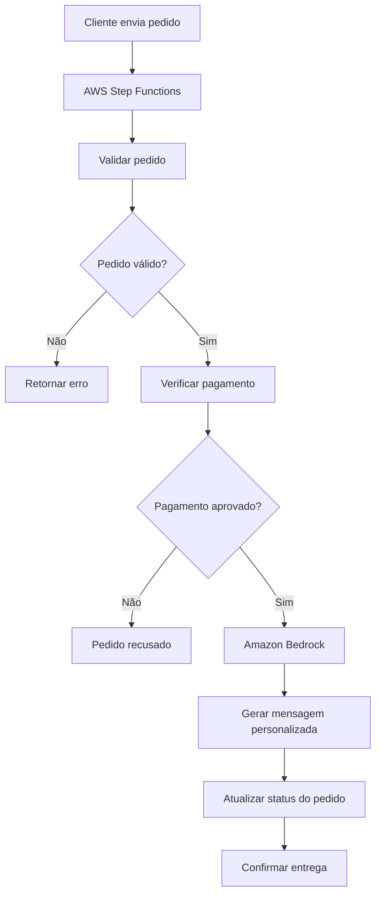

# Serverless Delivery AI Assistant


Assistente de delivery sem servidor com AWS Step Functions e Amazon Bedrock.

## Visão geral

Este projeto é uma implementação educacional para simular um assistente de delivery serverless. O fluxo local demonstra validação de pedido, verificação de pagamento, geração de mensagem personalizada e atualização de status sem criar recursos reais na AWS.

O projeto faz parte do desafio final do bootcamp **AWS - Agentes de IA em Campo** da DIO. Ele comunica como AWS Step Functions pode orquestrar decisões determinísticas enquanto Amazon Bedrock atua como camada de IA generativa para mensagens ao cliente.

## Objetivo do desafio

Criar uma base profissional, segura para GitHub público, que demonstre:

- Orquestração de pedidos com AWS Step Functions.
- Uso demonstrativo do Amazon Bedrock para mensagens personalizadas.
- Simulação local em Python.
- Exemplos de entrada e saída.
- Testes automatizados simples.
- Documentação clara em português.

Nenhum recurso AWS é criado automaticamente.

## Arquitetura



## Fluxo do pedido

1. O cliente envia o pedido.
2. O fluxo valida cliente, endereço, itens e status de pagamento.
3. Pedidos inválidos são encerrados sem chamar IA.
4. Pagamentos recusados ou pendentes seguem caminhos próprios.
5. Pagamentos aprovados geram um prompt para o Amazon Bedrock.
6. A simulação retorna mensagem, status e próximo passo.

## Tecnologias utilizadas

- Python 3.12+
- JSON
- Pytest
- AWS Step Functions
- Amazon Bedrock
- Git/GitHub

## Estrutura do projeto

```text
serverless-delivery-ai-assistant/
|-- README.md
|-- docs/
|-- examples/
|-- infrastructure/
|-- scripts/
|-- src/delivery_ai_assistant/
`-- tests/
```

## Como executar localmente

Crie e ative um ambiente virtual, instale as dependências e execute os testes:

```powershell
python -m venv .venv
.\.venv\Scripts\Activate.ps1
pip install -r requirements.txt
```powershell
python scripts/run_tests.py
python scripts/run_demo.py examples/order-approved.json
```

## Exemplos de entrada


Os arquivos em `examples/` incluem:

- `order-approved.json`: pedido válido com pagamento aprovado.
- `order-invalid.json`: pedido inválido.
- `payment-declined.json`: pedido válido com pagamento recusado.

## Exemplo de saída

Consulte `examples/sample-output.json` para uma resposta simulada de pedido aprovado.

## Como o AWS Step Functions é usado

A definição demonstrativa está em `infrastructure/state-machine.asl.json`. Ela representa estados como recebimento do pedido, validação, verificação de pagamento, chamada ao Bedrock, atualização de status e finalização.

Este arquivo é uma referência educacional e deve ser revisado antes de qualquer uso em produção.

## Como o Amazon Bedrock é usado

O Bedrock está representado como integração de IA generativa para criar mensagens personalizadas ao cliente. A simulação local apenas constrói o prompt em `src/delivery_ai_assistant/bedrock_prompt.py`; nenhuma API real é chamada.

O corpo da requisição do Bedrock pode variar conforme o foundation model escolhido. O `modelId` também deve ser ajustado conforme a região e os modelos habilitados na conta AWS.

## Segurança e boas práticas

- Não versionar `.env` real.
- Não versionar credenciais AWS, chaves privadas, tokens ou arquivos `.aws/`.
- Não usar dados reais de clientes nos exemplos.
- Validar entradas antes de enviar qualquer conteúdo para um modelo generativo.
- Evitar enviar dados sensíveis ao LLM.
- A política IAM em `infrastructure/iam-policy-example.json` usa `Resource: "*"` apenas para estudo. Em produção, aplique least privilege com ARNs específicos.
- Revisar custos antes de qualquer deploy real.

## Melhorias futuras

- Integração real com API Gateway.
- Persistência com DynamoDB.
- Lambdas para validação e atualização de status.
- Bedrock Guardrails.
- CloudWatch Logs e X-Ray.
- Integração com sistema de pagamento e chatbot.
- Deploy com SAM, CDK ou Terraform.
- Testes de carga e observabilidade de custos.

## Autora

Stefani Deri
